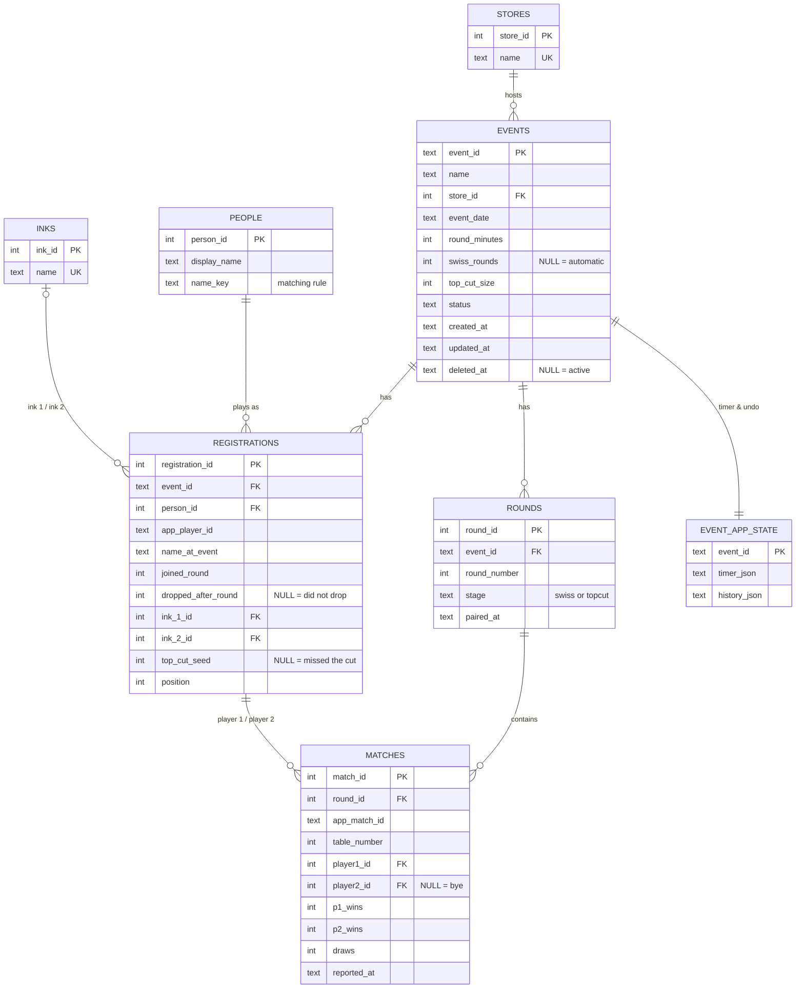

# Database Design

**Database:** SQLite, one file at `data/lorcana.db`
**Schema:** [`lorcana/schema.sql`](../../lorcana/schema.sql)
**Jira:** LTM-43 (design), LTM-44 (SQLite storage), LTM-45 (store, date, inks), LTM-46 (timestamps)

## Entity-relationship diagram



## How to read it

- **One store hosts many events.** Store is optional, so `store_id` can be empty.
- **People vs. registrations.** A *person* is a real human across all events. A
  *registration* is that person playing in one event, with their deck and drop
  status for that event. This split is what makes cross-event questions possible:
  attendance, retention, a player's history.
- **Matches point at registrations, not people.** A match happened within one
  event, so it links to that event's registrations. Join through registrations to
  reach the person.
- **A bye** is a match with no player 2.

## Design decisions

| Decision | Why |
|---|---|
| **Normalized tables** instead of one JSON blob per event | So events, players and matches can be queried, joined and aggregated with SQL across events. |
| **STRICT tables and CHECK constraints** | The database itself rejects impossible data: text in number columns, a 2–2 score, more than 3 games, a player paired against themselves, the same ink twice. |
| **Inks as a lookup table** | Only the six real inks can be stored, and reports group cleanly. |
| **Soft delete** (`deleted_at`) | A deleted event disappears from the app but stays in the database, so mistakes can be recovered and history isn't lost. |
| **Times as UTC ISO 8601 text** | Sorts correctly and works with SQLite date functions (`julianday`, `strftime`), and avoids daylight-saving confusion. |
| **App ids kept alongside database ids** (`app_player_id`, `app_match_id`) | The app keeps working with its own ids; the database uses integer keys for joins. |
| **Timer and undo history stay as JSON** (`event_app_state`) | Only the app ever reads them, always whole; they're never analyzed. |
| **Save = replace the event's rows in one transaction** | Simple and always consistent: either the whole event saves or nothing does. Fine at local-event scale. |

## Matching people across events (provisional)

Current rule: **same name, ignoring capitals and extra spaces, is the same person**,
unless that person is already registered in the same event (then a new person is
created, so two different "Alex"es in one event stay separate).

Known weaknesses: two different people with the same name at different events are
merged; "Sam K." and "Samantha Kim" are treated as different people. Discovery
task **LTM-48** will decide whether to use player IDs, emails or organizer
confirmation instead.

## Example query

How many events has each person played, and when did they first appear?

```sql
SELECT p.display_name,
       COUNT(*)          AS events_played,
       MIN(e.event_date) AS first_event
FROM people p
JOIN registrations r USING (person_id)
JOIN events e USING (event_id)
WHERE e.deleted_at IS NULL
GROUP BY p.person_id
ORDER BY events_played DESC;
```

## Looking at the data yourself

Open `data/lorcana.db` in **DB Browser for SQLite** (free) and use the
**Execute SQL** tab, or in Terminal:

```bash
sqlite3 -readonly -header -column data/lorcana.db
```

`-readonly` makes sure you can't change anything by accident while exploring.
